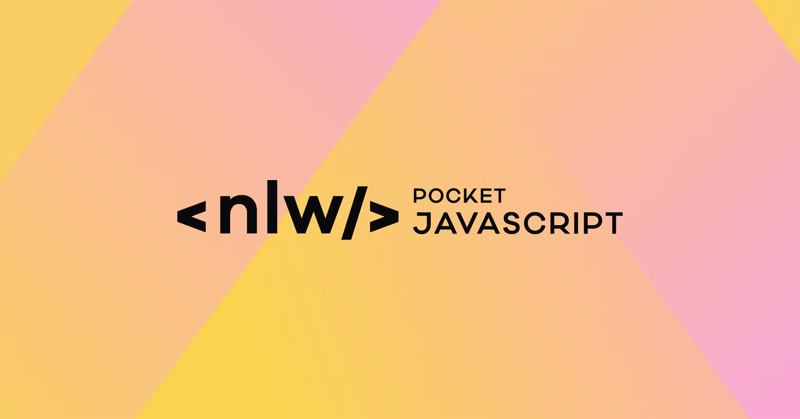

<h1 align="center"> NLW Pocket - App de Metas 🎯</h1>

Gerenciador de metas no terminal com Node.js, feito no NLW Pocket da Rocketseat

  <a href="#-tecnologias">Tecnologias</a>&nbsp;&nbsp;&nbsp;|&nbsp;&nbsp;&nbsp;
  <a href="#-projeto">Projeto</a>

  
 

## 🚀 Tecnologias

Esse projeto foi desenvolvido com as seguintes tecnologias:

- JavaScript
- Node.js
- Inquirer
- Git e Github

## 💻 Projeto

- O App de Metas foi desenvolvido no NLW Pocket da Rocketseat: uma aplicação de terminal com menu interativo para cadastrar metas, listar e marcar as concluídas, ver separadamente as metas realizadas e abertas e deletar metas.

- Foi construído com Node.js e os prompts interativos do Inquirer (seleção, checkbox e entrada de texto), com as metas salvas em um arquivo `metas.json` lido e gravado pelo módulo `fs`, para que persistam entre execuções.

<h2 align="center">📌 Desenvolvedores</h2>

<table align="center">
  <tr>
    <td align="center">
      <a href="https://github.com/rebellatoGui" title="GitHub">
         
        
          <b>Guilherme Rebellato</b>
        
      </a>
    </td>
  </tr>
</table>

 

---

Feito com ♥ por rebellatoGui

